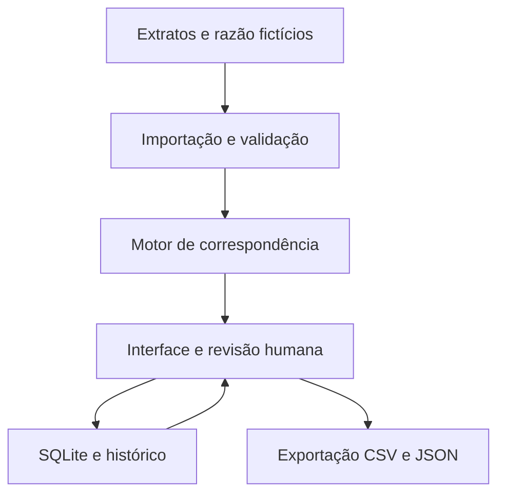

# Treasury Bridge

**Conferência bancária com valores exatos, evidências e revisão humana.**

Prova de conceito em Python para comparar extratos bancários com registros contábeis já contabilizados.
Identifica diferenças e pendências sem confundir saldo líquido com conciliação.
Todos os arquivos, empresas, contas e identificadores da demonstração são fictícios.

## Experimente em dois comandos

Requer Python 3.11 ou superior. A demonstração CSV usa somente a biblioteca padrão.

```bash
python run.py demo
python run.py serve
```

Abra **http://127.0.0.1:8765** e selecione **Abrir demonstração**.
No Windows, `py` pode substituir `python`. Para outra porta: `python run.py serve --port 8766`.

O primeiro comando gera os arquivos sintéticos em `data/synthetic/` e os relatórios em `var/report.json` e `var/report.csv`.
O segundo oferece interface local para importar arquivos, examinar candidatos, aprovar vínculos e manter pendências.
As revisões ficam em `var/reviews.sqlite`; reabrir a mesma execução preserva seu histórico.

## O problema de negócio

O cenário de descoberta já possui uma etapa de recebimento e importação bancária no ERP,
com parte das contabilizações automatizada. A oportunidade explorada aqui é a conferência posterior:
encontrar o que explica as diferenças e dar suporte à revisão de exceções.

Entradas e saídas são conferidas em **contas contábeis distintas**. O critério numérico é:

**Diferença = total do banco − total contabilizado**, dentro da mesma empresa, conta bancária,
conta contábil, moeda, direção e conjunto de arquivos do período.

Uma entrada de 100 e uma saída de 100 não se compensam para encerrar a conferência.
Mesmo diferença zero não libera o grupo se existirem itens sem vínculo ou ambíguos.

## O que funciona na v0.1

- Importação de três contratos de extrato CSV: português, inglês com valor assinado e canônico.
- Importação de razão contábil fictício com `posting_status=POSTED`.
- Leitura XLSX opcional; arquivos com fórmulas são recusados.
- Comparação exata de valor e CNPJ, com escopo isolado e janela configurável de datas.
- Respeito a referências explícitas: duas referências preenchidas e diferentes impedem o vínculo.
- Detecção de concorrência entre candidatos; nenhum lançamento é reutilizado.
- Revisão de correspondências e seleção humana entre candidatos compatíveis.
- Persistência SQLite, histórico de decisões e exportações CSV/JSON.
- Interface em português, adaptável a telas menores, sem serviços externos.
- Testes de regras, importação, revisão e API HTTP; workflow de CI no GitHub.

## Roteiro de demonstração em três minutos

1. Abra o cenário. São **20 movimentos bancários, 19 registros contábeis e 12 contas fictícias**.
2. Observe DEMO-01: os totais fecham, mas CNPJ ausente, referência conflitante e candidatos repetidos mantêm pendências.
3. Observe a saída de DEMO-02: há **20,00 BRL de diferença**, correspondente ao movimento B020 sem contabilização.
   Clique em **Há pendências →** para ir diretamente aos itens daquela empresa, conta, moeda e fluxo.
   O recorte filtra as movimentações e os registros contábeis sem vínculo. Use **Ver todas as contas** para limpar a seleção.
4. Filtre **Pendências**. B003 e B004 possuem dois candidatos compatíveis; a regra não escolhe sozinha.
5. Abra B003, selecione L003, informe responsável e justificativa e aprove. Um segundo vínculo ao mesmo L003 será recusado.
6. Examine B001: CNPJ, valor, escopo e referência são compatíveis. Aprove a sugestão e confira o histórico.
7. Exporte o CSV e o JSON. O CSV inclui registros contábeis sem vínculo; o JSON inclui todo o histórico.

Não altere valores apenas para fazer os totais fecharem. Erros de origem devem ser investigados e corrigidos no sistema responsável;
a ferramenta serve para localizar e documentar a divergência.

## Instalação opcional e arquivos próprios de teste

```bash
python -m pip install -e '.[excel]'
treasury-bridge serve
python run.py reconcile --bank data/synthetic/bank_alpha.csv data/synthetic/bank_beta.csv data/synthetic/bank_canonical.csv --ledger data/synthetic/ledger.csv --window 2 --out var/conferencia.json
python -m unittest discover -s tests -v
```

Em PowerShell, as aspas simples acima também são aceitas. Sem instalar o extra Excel, use CSV.
Leia [os contratos de entrada](docs/CONTRACTS.md) antes de preparar outros arquivos fictícios.

## Como a correspondência funciona

O motor cria candidatos usando CNPJ normalizado, valor decimal exato, empresa, conta bancária,
conta contábil, moeda e direção iguais; a data precisa estar na janela em dias corridos.
Referências diferentes, quando ambas existem, bloqueiam a associação.

A proposta por regra exige exclusividade nos dois lados. O grafo de candidatos é calculado antes das associações:
nenhum algoritmo guloso escolhe a primeira linha de mesmo valor. A seleção humana é aceita somente entre candidatos válidos
e não permite reutilização. Depois de uma revisão, a ambiguidade original dos demais itens continua explícita.

| Estado | Significado |
|---|---|
| `RULE_MATCH` | Correspondência exclusiva sugerida por regra; ainda não aprovada por pessoa |
| `APPROVED` | Vínculo aprovado com responsável e justificativa |
| `AMBIGUOUS` | Mais de um vínculo possível ou concorrência pelo mesmo registro |
| `MISSING_ID` | Ausência de CNPJ impede associação automática |
| `UNMATCHED` | Nenhum candidato atende às regras |
| `HELD` | Sugestão rejeitada; investigação pendente |

Um grupo fica `PENDING` se tem diferença ou itens pendentes; `READY_FOR_REVIEW` se todos os itens têm vínculo por regra,
sem diferença; `REVIEWED` se também foram aprovados por pessoa. **Nenhum desses estados grava ou encerra algo no ERP.**

## Arquitetura



Domínio e motor não dependem da interface HTTP, do SQLite ou de um ERP.
`Decimal` preserva valores exatos. A interface usa HTML, CSS e JavaScript sem bibliotecas externas.
Detalhes: [decisões](docs/DECISIONS.md), [mapeamento](docs/DISCOVERY.md), [estado](docs/STATE.md).

## Limites e próximos passos

Esta versão **não utiliza IA**, não se conecta a bancos, SAP ou PowerApps e não faz contabilizações.
Também não implementa pagamentos agrupados, parciais, conversão cambial, calendários de dias úteis,
validação fiscal de CNPJ nem uma implantação corporativa multiusuário.

A aplicação serve exclusivamente em `127.0.0.1`. Responsável informado não equivale a autenticação.
O histórico é um registro de aplicação, não uma trilha inviolável; administradores locais podem editar a base.
Arquivos importados e dados normalizados ficam no computador. Não há promessa de retenção zero.
Limites: 5 mil linhas por arquivo, 20 arquivos por envio, 3 MB por requisição e 2 milhões de comparações por execução.

Evolução planejada: regras configuráveis por ambiente, evidências adicionais para exceções, avaliação de um módulo opcional
de IA e acompanhamento cambial com fontes e horários. Não há módulo de câmbio ou previsões implementado nesta versão.

## Autoria e continuidade

Projeto de portfólio de **Andrew Fernandes Monteiro**, a partir de levantamento conversacional sobre rotinas de tesouraria,
com implementação assistida por IA. Não representa produto oficial, implantação ou resultado operacional de uma empresa.
Não contém documentos corporativos nem afirma economia de tempo que ainda não foi medida.

Para outro modelo ou desenvolvedor continuar: comece por [AGENTS.md](AGENTS.md),
[HANDOFF.md](docs/HANDOFF.md) e [STATE.md](docs/STATE.md).
