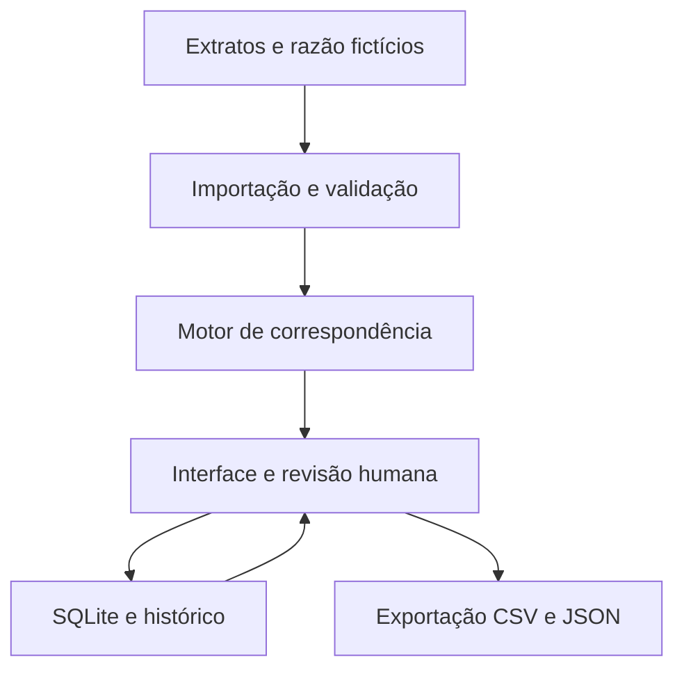

# Treasury Bridge

**Conferência bancária com valores exatos, evidências e revisão humana.**

Prova de conceito em Python para comparar extratos bancários com registros contábeis já contabilizados.
Identifica diferenças e pendências sem confundir saldo líquido com conciliação.
Todos os arquivos, empresas, contas e identificadores da demonstração são fictícios.

## Começar no Windows

**Baixar ZIP → Extrair Tudo → abrir INICIAR_WINDOWS.bat → clicar em Abrir demonstração.**

A ferramenta funciona no seu computador e mostra a interface no navegador.
Você precisa de **Python 3.11 ou superior** e da pasta completa do projeto extraída.
Para experimentar os dados fictícios, não precisa instalar bibliotecas, usar Git ou configurar uma chave de API.

### 1. Verificar o Python

Se já conseguiu abrir a ferramenta neste computador, pode passar para a próxima etapa.
Se ainda não tem Python, instale uma versão estável pelo [site oficial para Windows](https://www.python.org/downloads/windows/).
Python 3.13 é uma das versões verificadas pelo projeto. A instalação também é explicada na
[documentação oficial em português](https://docs.python.org/pt-br/3/using/windows.html).

Se quiser conferir a instalação, abra o Prompt de Comando e digite:

```bat
py --version
```

O resultado deve ser `Python 3.11` ou superior, por exemplo `Python 3.13.x`.
Se `py` não for reconhecido, tente `python --version`.
O iniciador abaixo procura automaticamente uma instalação compatível por esses dois comandos.

### 2. Baixar e extrair o projeto

1. Clique em [Baixar o projeto em ZIP](https://github.com/andrew-drew-beep/treasury-bridge-core/archive/refs/heads/main.zip).
   No GitHub, o mesmo download fica em **Code → Download ZIP**.
2. Na pasta Downloads, clique com o botão direito no ZIP e escolha **Extrair Tudo**.
3. Abra a pasta extraída até encontrar **INICIAR_WINDOWS.bat**, **run.py** e a pasta **src** juntos.

Faça a extração completa antes de abrir o programa. Abrir um arquivo de dentro do ZIP não disponibiliza o restante do projeto.

### 3. Abrir a ferramenta

1. Na pasta extraída, dê **dois cliques em INICIAR_WINDOWS.bat**.
2. Uma janela de terminal deve permanecer aberta. Quando iniciar, ela mostrará:

```text
Treasury Bridge: http://127.0.0.1:8765
```

3. O iniciador tenta abrir esse endereço no navegador. Se a página não abrir, acesse **http://127.0.0.1:8765** manualmente.
4. Na página, clique em **Abrir demonstração**. Os dados fictícios são carregados automaticamente.

**Mantenha a janela do terminal aberta durante o uso.** É ela que mantém a ferramenta funcionando.
O arquivo `run.py` é a entrada por linha de comando; para iniciar com duplo clique, use o `.bat`.
O iniciador mostra mensagens de erro e aguarda uma tecla antes de fechar.

### Alternativa pelo terminal

Se preferir usar comandos, abra a pasta onde está `run.py`. Clique na barra de endereço do Explorador de Arquivos,
apague o caminho, digite `cmd` e pressione Enter. Na janela que abrir, execute:

```bat
py -3 run.py serve
```

Se `py` não estiver disponível, use `python run.py serve`.
Depois abra **http://127.0.0.1:8765** e clique em **Abrir demonstração**.
Para manter uma janela aberta mesmo quando ocorrer um erro, também é possível digitar na barra de endereço da pasta:

```bat
cmd /k py -3 run.py serve
```

### Encerrar e abrir novamente

Para encerrar, volte ao terminal e pressione **Ctrl+C**. No iniciador por duplo clique, o Windows pode pedir
confirmação para interromper o lote; em seguida a janela pode ser fechada.
Para usar outra vez, abra **INICIAR_WINDOWS.bat** e acesse a página.
Fechar apenas a aba do navegador deixa o servidor em execução.

### Atualizar preservando as revisões

1. Encerre o servidor com Ctrl+C.
2. Faça uma cópia da pasta **var**, dentro do seu projeto: ela contém o histórico salvo.
3. Baixe e extraia o ZIP atualizado. Copie seu conteúdo para a pasta do projeto existente e aceite substituir os arquivos.
4. Mantenha a pasta **var** nessa mesma pasta do projeto. O ZIP não inclui essa pasta.
   Se preferir usar uma pasta nova, copie o seu `var` para dentro dela antes de iniciar.
5. Abra o iniciador novamente e pressione **Ctrl+F5** no navegador para carregar a interface atualizada.

As revisões ficam em `var/reviews.sqlite`; reabrir a mesma execução preserva seu histórico.

## Se não abrir

| O que aparece ou acontece | Como resolver |
|---|---|
| A janela abre e fecha ao clicar em run.py | Abra INICIAR_WINDOWS.bat, ou siga a alternativa pelo terminal acima. |
| Python não encontrado ou versão anterior a 3.11 | Instale uma versão compatível pelo site oficial. Feche o terminal e tente o iniciador novamente. |
| O gerenciador Python foi instalado, mas ainda não há uma versão disponível | Siga a orientação do gerenciador. Nele, `py install 3.13` instala uma versão compatível. Esse comando é específico do gerenciador atual. |
| `can't open file ... run.py` | O terminal está em outra pasta. Abra a pasta que contém run.py e inicie o terminal pela barra de endereço dela. |
| `No module named treasury_bridge` ou arquivos incompletos | Extraia o ZIP inteiro e mantenha run.py e a pasta src juntos. |
| Porta 8765 em uso / erro 10048 | Confira se já existe uma janela da ferramenta aberta. Use a página existente ou encerre essa instância com Ctrl+C. |
| A página diz que não é possível acessar o site | Confira se o terminal permanece aberto e se mostrou o endereço. Use exatamente http://127.0.0.1:8765, com http. |
| A página abre, mas ainda está igual após atualizar | Confirme que iniciou a pasta atualizada e pressione Ctrl+F5. |
| A importação XLSX pede uma dependência | Use CSV para a demonstração ou instale o extra Excel, explicado abaixo. |

Se ainda houver erro, copie a mensagem completa do terminal ou faça uma captura dessa janela.

## macOS e Linux

Baixe e extraia o projeto. Abra um terminal dentro da pasta que contém `run.py` e execute:

```bash
python3 run.py serve
```

Requer Python 3.11 ou superior. Abra **http://127.0.0.1:8765** e clique em **Abrir demonstração**.
Mantenha o terminal aberto; Ctrl+C encerra o servidor.
Para outra porta, use `python3 run.py serve --port 8766` e abra **http://127.0.0.1:8766**.
O iniciador `.bat` é exclusivo do Windows.

## O problema de negócio

O cenário de descoberta já possui uma etapa de recebimento e importação bancária no ERP,
com parte das contabilizações automatizada. A oportunidade explorada aqui é a conferência posterior:
encontrar o que explica as diferenças e dar suporte à revisão de exceções.

Entradas e saídas são conferidas em **contas contábeis distintas**. O critério numérico é:

**Diferença = total do banco − total contabilizado**, dentro da mesma empresa, conta bancária,
conta contábil, moeda, direção e conjunto de arquivos do período.

Uma entrada de 100 e uma saída de 100 não se compensam para encerrar a conferência.
Mesmo diferença zero não libera o grupo se existirem itens sem vínculo ou ambíguos.

## O que funciona na v0.1

- Importação de três contratos de extrato CSV: português, inglês com valor assinado e canônico.
- Importação de razão contábil fictício com `posting_status=POSTED`.
- Leitura XLSX opcional; arquivos com fórmulas são recusados.
- Comparação exata de valor e CNPJ, com escopo isolado e janela configurável de datas.
- Respeito a referências explícitas: duas referências preenchidas e diferentes impedem o vínculo.
- Detecção de concorrência entre candidatos; nenhum lançamento é reutilizado.
- Revisão de correspondências e seleção humana entre candidatos compatíveis.
- Persistência SQLite, histórico de decisões e exportações CSV/JSON.
- Interface em português, adaptável a telas menores, sem serviços externos.
- Testes de regras, importação, revisão e API HTTP; workflow de CI no GitHub.

## Roteiro de demonstração em três minutos

1. Abra o cenário. São **20 movimentos bancários, 19 registros contábeis e 12 contas fictícias**.
2. Observe DEMO-01: os totais fecham, mas CNPJ ausente, referência conflitante e candidatos repetidos mantêm pendências.
3. Observe a saída de DEMO-02: há **20,00 BRL de diferença**, correspondente ao movimento B020 sem contabilização.
   Clique em **Há pendências →** para ir diretamente aos itens daquela empresa, conta, moeda e fluxo.
   O recorte filtra as movimentações e os registros contábeis sem vínculo. Use **Ver todas as contas** para limpar a seleção.
4. Filtre **Pendências**. B003 e B004 possuem dois candidatos compatíveis; a regra não escolhe sozinha.
5. Abra B003, selecione L003, informe responsável e justificativa e aprove. Um segundo vínculo ao mesmo L003 será recusado.
6. Examine B001: CNPJ, valor, escopo e referência são compatíveis. Aprove a sugestão e confira o histórico.
7. Exporte o CSV e o JSON. O CSV inclui registros contábeis sem vínculo; o JSON inclui todo o histórico.

Não altere valores apenas para fazer os totais fecharem. Erros de origem devem ser investigados e corrigidos no sistema responsável;
a ferramenta serve para localizar e documentar a divergência.

## Recursos opcionais para desenvolvimento

Os comandos abaixo são adicionais. O iniciador e a demonstração CSV já funcionam sem esta instalação.

### Habilitar importação de planilhas Excel

Abra o terminal na pasta do projeto. No Windows:

```bat
py -3 -m pip install -e ".[excel]"
```

Se seu computador usa o comando `python`, substitua `py -3` por `python`.
No macOS/Linux, use `python3`.
Depois reinicie o servidor. O CSV continua disponível sem a dependência extra.

### Usar pelo terminal e executar os testes

Os exemplos abaixo usam `python`; no Windows também pode ser `py -3`, e no macOS/Linux, `python3`.

```bash
python run.py demo
python run.py reconcile --bank data/synthetic/bank_alpha.csv data/synthetic/bank_beta.csv data/synthetic/bank_canonical.csv --ledger data/synthetic/ledger.csv --window 2 --out var/conferencia.json
python -m unittest discover -s tests -v
```

`demo` gera arquivos fictícios em `data/synthetic/` e relatórios em `var/report.json` e `var/report.csv`.
Esse comando não inicia a interface. Para abrir a tela, use o iniciador ou `serve`.
Leia [os contratos de entrada](docs/CONTRACTS.md) antes de preparar outros arquivos fictícios.

## Como a correspondência funciona

O motor cria candidatos usando CNPJ normalizado, valor decimal exato, empresa, conta bancária,
conta contábil, moeda e direção iguais; a data precisa estar na janela em dias corridos.
Referências diferentes, quando ambas existem, bloqueiam a associação.

A proposta por regra exige exclusividade nos dois lados. O grafo de candidatos é calculado antes das associações:
nenhum algoritmo guloso escolhe a primeira linha de mesmo valor. A seleção humana é aceita somente entre candidatos válidos
e não permite reutilização. Depois de uma revisão, a ambiguidade original dos demais itens continua explícita.

| Estado | Significado |
|---|---|
| `RULE_MATCH` | Correspondência exclusiva sugerida por regra; ainda não aprovada por pessoa |
| `APPROVED` | Vínculo aprovado com responsável e justificativa |
| `AMBIGUOUS` | Mais de um vínculo possível ou concorrência pelo mesmo registro |
| `MISSING_ID` | Ausência de CNPJ impede associação automática |
| `UNMATCHED` | Nenhum candidato atende às regras |
| `HELD` | Sugestão rejeitada; investigação pendente |

Um grupo fica `PENDING` se tem diferença ou itens pendentes; `READY_FOR_REVIEW` se todos os itens têm vínculo por regra,
sem diferença; `REVIEWED` se também foram aprovados por pessoa. **Nenhum desses estados grava ou encerra algo no ERP.**

## Arquitetura



Domínio e motor não dependem da interface HTTP, do SQLite ou de um ERP.
`Decimal` preserva valores exatos. A interface usa HTML, CSS e JavaScript sem bibliotecas externas.
Detalhes: [decisões](docs/DECISIONS.md), [mapeamento](docs/DISCOVERY.md), [estado](docs/STATE.md).

## Limites e próximos passos

Esta versão **não utiliza IA**, não se conecta a bancos, SAP ou PowerApps e não faz contabilizações.
Também não implementa pagamentos agrupados, parciais, conversão cambial, calendários de dias úteis,
validação fiscal de CNPJ nem uma implantação corporativa multiusuário.

A aplicação serve exclusivamente em `127.0.0.1`. Responsável informado não equivale a autenticação.
O histórico é um registro de aplicação, não uma trilha inviolável; administradores locais podem editar a base.
Arquivos importados e dados normalizados ficam no computador. Não há promessa de retenção zero.
Limites: 5 mil linhas por arquivo, 20 arquivos por envio, 3 MB por requisição e 2 milhões de comparações por execução.

Evolução planejada: regras configuráveis por ambiente, evidências adicionais para exceções, avaliação de um módulo opcional
de IA e acompanhamento cambial com fontes e horários. Não há módulo de câmbio ou previsões implementado nesta versão.

## Autoria e continuidade

Projeto de portfólio de **Andrew Fernandes Monteiro**, a partir de levantamento conversacional sobre rotinas de tesouraria,
com implementação assistida por IA. Não representa produto oficial, implantação ou resultado operacional de uma empresa.
Não contém documentos corporativos nem afirma economia de tempo que ainda não foi medida.

Para outro modelo ou desenvolvedor continuar: comece por [AGENTS.md](AGENTS.md),
[HANDOFF.md](docs/HANDOFF.md) e [STATE.md](docs/STATE.md).
